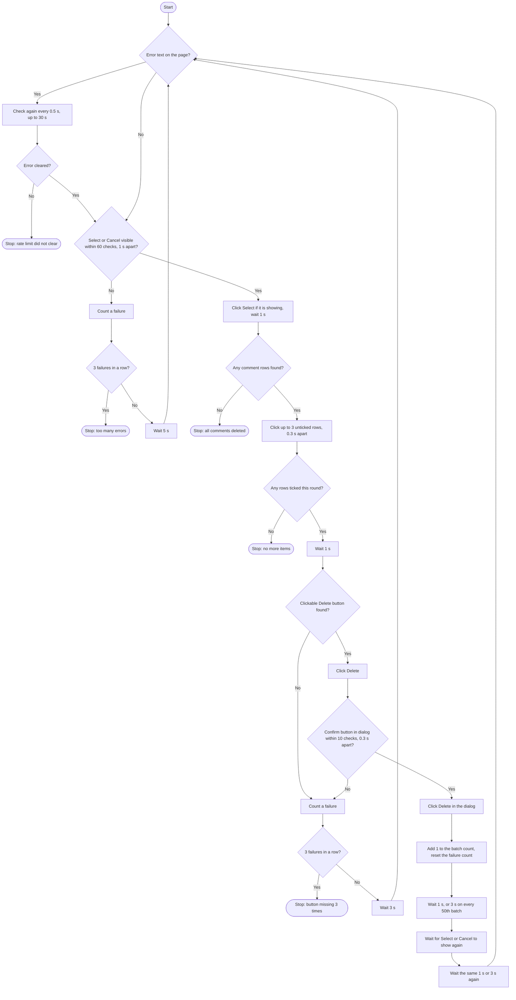
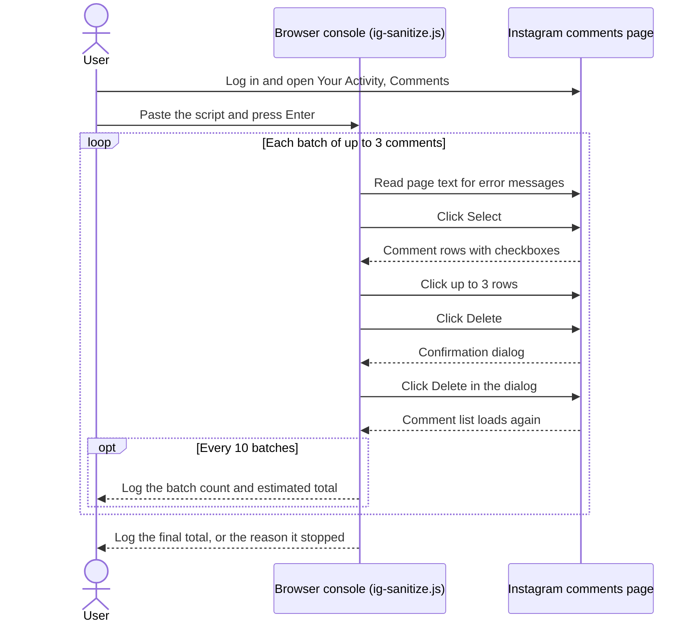

# IG Sanitize: bulk delete your Instagram comments from the browser console

IG Sanitize is a browser console script that deletes all of your own Instagram comments, three at a time, from the Your Activity page.

It is for one job: cleaning up the comment history of an account you own and are logged in to. You open Instagram's own "Your Activity" comments page, paste the script into the developer console, and it clicks Select, ticks three comments, clicks Delete and confirms, then repeats until the list is empty or Instagram starts returning errors. It cannot touch anyone else's comments, because it only presses the buttons Instagram shows you for your own.

There are two ways to run it:

- [`ig-sanitize.js`](ig-sanitize.js): paste it into the console. No install.
- [`ig-sanitize-runner.py`](ig-sanitize-runner.py): a Python script that drives the same clicks from outside the browser through the Chrome DevTools Protocol. It reloads the page when the list stops loading and keeps a running count between runs.

## Why delete your Instagram comment history

Every comment you have left is public on the post where you left it. Read together, years of comments show what you said, who you said it to and when. Instagram lets you remove them, but only a few at a time by hand. This script does the same clicks for you.

Deleting comments on Instagram does not remove copies that someone else already saved or archived. It cleans the source only.

## How to bulk delete your Instagram comments

### Option A: paste the script into the console

1. Log in to Instagram in a desktop browser and go to `https://www.instagram.com/your_activity/interactions/comments/`. You can also get there from your profile: Your Activity, then Interactions, then Comments.
2. Open the developer console.
   - Chrome or Edge: `Ctrl+Shift+J` on Windows, `Cmd+Option+J` on Mac
   - Firefox: `Ctrl+Shift+K` on Windows, `Cmd+Option+K` on Mac
3. Copy the whole of [`ig-sanitize.js`](ig-sanitize.js), paste it into the console and press Enter.
4. Leave the tab open. Closing or reloading the tab stops the script.

The script logs a line every 10 batches and a total when it stops:

```text
Batch 40 (~120 comments deleted)
Batch 50 (~150 comments deleted)
Pausing to avoid rate limiting...
All comments deleted! Total batches: 145
Done! Total: ~435 comments in 145 batches
```

The comment counts are estimates. The script multiplies the number of batches by 3, so a final batch of one or two comments is still counted as three.

### Option B: the Python runner, for long comment histories

The runner needs Python, the `websockets` package, and Chrome started with remote debugging on port 9222. Close every Chrome window first, then start Chrome with the comments page open.

```powershell
Start-Process "C:\Program Files\Google\Chrome\Application\chrome.exe" `
  -ArgumentList '--remote-debugging-port=9222',
    '--user-data-dir=C:\Users\<you>\AppData\Local\Google\Chrome\User Data',
    'https://www.instagram.com/your_activity/interactions/comments/'
```

```bash
# macOS
/Applications/Google\ Chrome.app/Contents/MacOS/Google\ Chrome \
    --remote-debugging-port=9222 \
    'https://www.instagram.com/your_activity/interactions/comments/'
```

Log in to Instagram in that window if you are not already, then run:

```bash
pip install websockets
python ig-sanitize-runner.py
```

The runner connects to `127.0.0.1:9222`, picks the first open tab whose address contains "instagram", and loads the comments page. It prints a line for every batch. Press `Ctrl+C` to stop.

It differs from the console script in three ways:

- When it cannot find the Select button or any comment rows, it reloads the comments page and tries again. It stops after 5 failures in a row.
- It saves the batch count in the page's `localStorage` (key `ig_sanitize_batches`) every 10 batches and again when it stops, so the running total carries over to the next run. It removes the key when nothing is left to select.
- It does not look for Instagram's error messages. The reload is its only recovery step.

Comments that are already deleted stay deleted, so running either script again continues with whatever is left.

[`headless.md`](headless.md) has more on driving Chrome this way, and [`REQUIREMENTS.md`](REQUIREMENTS.md) lists versions.

## How it works

Instagram's comments activity page has a Select button. Once you press it, each comment becomes a row you can tick, and a Delete button appears. The script works through that same interface:

1. Read the page text. If it contains "something went wrong", "please try again" or "try again later", wait for the message to clear.
2. Wait until a Select or Cancel button is visible, which means the list has loaded.
3. Click Select, unless the page is already in select mode.
4. Click up to 3 rows that are not ticked yet. It clicks the row itself, because the checkbox icon inside it does not accept clicks.
5. Click Delete. The page holds more than one Delete element, and the script uses the visible one whose computed style accepts pointer events.
6. Wait for the confirmation dialog and click the Delete button inside it.
7. Wait for the list to load again, then go back to step 1.

### The delete loop



### Who does what



## Settings

The settings are constants at the top of [`ig-sanitize.js`](ig-sanitize.js). Edit them before you paste.

| Setting | Default | What it controls |
| --- | --- | --- |
| `DELETION_BATCH_SIZE` | `3` | Comments ticked and deleted per batch |
| `DELAY_BETWEEN_ACTIONS_MS` | `1000` | Pause after clicking Select, before clicking Delete, and twice after each batch |
| `DELAY_BETWEEN_CHECKBOX_CLICKS_MS` | `300` | Pause between ticking one row and the next |
| `MAX_RETRIES` | `60` | Number of one-second checks for the list to load before the script counts a failure |
| `RATE_LIMIT_COOLDOWN_MS` | `30000` | Declared but not read by the loop. The cooldown is fixed in `waitForRateLimit` at 60 checks, 0.5 seconds apart |
| `MAX_CONSECUTIVE_ERRORS` | `3` | Failures in a row before the script stops |

Two pauses are not settings: the extra wait on every 50th batch (3 seconds in place of 1, applied twice) and the 5 or 3 second wait after a failure.

The Python runner has its own fixed values in the code: 3 comments per batch, 0.4 seconds between ticks, and a stop after 5 failures in a row.

## Is it safe to mass delete Instagram comments this way

The script never asks for your username or password and never reads them. It runs inside a tab where you are already logged in.

`ig-sanitize.js` makes no network requests of its own. It reads the page, clicks buttons and writes to the console. Read it before you run it. It is one file of about 230 lines, and pasting code you have not read into a logged-in browser tab is a risk with any script.

Deletion is permanent as far as this tool goes. It has no undo and keeps no copy of what it removes.

The script automates clicks on Instagram's site. Instagram's terms may not allow that, and Instagram can limit or act against accounts for automated activity. Read the terms yourself and run this at your own risk, on your own account.

## Limits and known issues

### Rate limits

Instagram shows a "something went wrong" message when deletions come too fast. The console script handles it as far as it can:

1. Before each batch it checks the page text for Instagram's error messages.
2. If it finds one, it rechecks every half second for up to 30 seconds and carries on once the message is gone. If the message is still there after 30 seconds, it stops and logs how many batches it finished.
3. On every 50th batch it waits longer before starting the next one.
4. After 3 failures in a row (list not loading, Delete button missing, or confirm button missing) it stops and logs how far it got.

In our own runs, Instagram started throttling after roughly 1,000 to 1,200 deletions in one session. The page then stopped loading comments until the limit cleared, which took a few hours. That limit belongs to the account and the script cannot get around it. Wait, then run it again.

### A false "all comments deleted"

The script treats "no comment rows found" as finished. If Instagram shows the Select button but no rows, it stops with the success message. Reload the page and check before you trust it.

### English interface only

The script finds buttons by the words Select, Cancel and Delete, and finds errors by English phrases. With Instagram set to another language it will not find them.

### Changes to Instagram's page

If Instagram changes the page, the script stops working. These are the selectors it relies on:

- `[aria-label="Delete"]`: the Delete button
- `[role="button"][aria-label="Image with button"]`: comment rows in select mode
- `[aria-label="Toggle checkbox"]`: the checkbox icon, read to see whether a row is already ticked
- `[role="dialog"]`: the confirmation dialog
- The text `Select` and `Cancel`: the mode toggle

### What it does not do

- Remove your likes, story replies or search history
- Delete posts, or anyone else's comments
- Change your privacy settings
- Remove copies of your comments that other people or services already saved

## FAQ

### Does it need my Instagram password?

No. Nothing in either script asks for or reads a password, a cookie or a token. Both work in a browser tab where you have already logged in yourself.

### Does it send my data anywhere?

The console script has no code that sends anything: no `fetch`, no upload, no analytics. The Python runner talks to Chrome on your own machine at `127.0.0.1:9222` and stores a single number, the batch count, in the page's `localStorage`.

### How fast does it delete comments?

Slowly, on purpose. With the default settings the fixed waits in the console script add up to at least 5.2 seconds per batch of 3, so the ceiling is about 34 comments a minute. Real runs are slower, because the script also waits for Instagram to reload the list after each batch. The Python runner's fixed waits come to about 10 seconds per batch.

### What happens if Instagram changes its page?

In most cases the script fails to find a button, counts a failure, and stops after 3 in a row without deleting anything further. The exception is the comment row selector: if that one stops matching, the script reports that all comments are deleted when they are not. See [A false "all comments deleted"](#a-false-all-comments-deleted).

### Can I get deleted comments back?

Not with this tool. It has no undo and saves nothing before deleting.

## Roadmap

- [x] Comment deletion (we have run it against a history of more than 1,700 comments)
- [x] Rate limit detection and cooldown in the console script
- [x] Python runner that keeps a batch count between runs
- [ ] Like removal (`/your_activity/interactions/likes/`)
- [ ] Story reply deletion (`/your_activity/interactions/story_replies/`)
- [ ] Search history clearing (`/your_activity/search_history/`)
- [ ] Docker container for scheduled headless runs

## Credits

- Original comment deletion script by [sbolel](https://gist.github.com/sbolel/a2b2bfde16b3ab185fbc2e2049240abc)
- Reworked for Instagram's page structure as of August 2026: finding Select by its text, clicking the parent row in place of the checkbox, filtering Delete buttons by `pointer-events`, and looking for the confirm button only inside the dialog

## License

MIT. See [LICENSE](LICENSE).

More from CyberAutomations: [how IG Sanitize was built and what it does](https://cyberautomations.com/work/ig-comment-activity-deleter?utm_source=github&utm_medium=readme&utm_campaign=ig-comment-activity-deleter)


<!-- ca-tracked-link -->
[cyberautomations.com](https://cyberautomations.com/?utm_source=github&utm_medium=readme&utm_campaign=ig-comment-activity-deleter)
